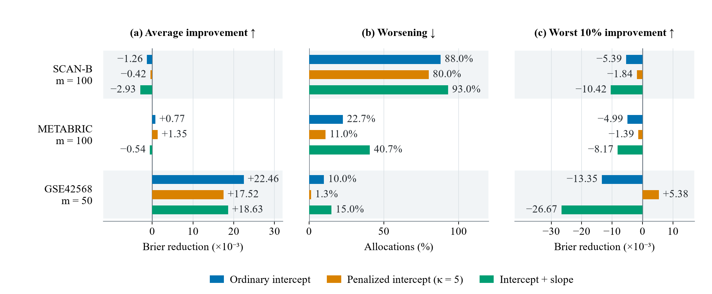

# Small-Sample Recalibration for Breast Cancer Survival Prediction

[](https://github.com/dall-ly/breast-survival-recalibration/actions/workflows/verify.yml)

Research code for **Benefits and Risks of Small Sample Recalibration for Breast Cancer Survival Prediction**, by Kai Deng and Weinan Wang.

This study compares prediction error and updating risk when local calibration samples are small. It evaluates unchanged predictions, ordinary intercept updating, penalized intercept updating, and intercept-and-slope updating across SCAN-B, METABRIC, and GSE42568, using 300 paired allocations per setting.



Penalized intercept updating reduced worsening frequency and upper-decile mean error change relative to ordinary updating in all 30 cohort–predictor–size settings. Mean error was lower in 24. GSE42568 illustrates the trade-off: stronger correction achieved lower average error, while shrinkage produced fewer unfavorable updates.

## Reproduce the paper figures and tables

Python 3.11 or newer is recommended. From the repository root:

```bash
python -m venv .venv
# Activate the environment, then:
python -m pip install -r requirements.txt
python reproduce.py
```

This uses the included allocation-level scores to regenerate the paired summaries, sensitivity tables, and all three figures. It does not require patient records or refitting. Figures are exported as PDF, SVG, and 300 dpi PNG. Install Times New Roman for the manuscript typography; a local font fallback may otherwise change the appearance.

| Paper item | Code | Result |
|---|---|---|
| Figure 1 — study design | `figures/plot_workflow.py` | `figures/fig1_workflow.*` |
| Figure 2 — main comparison | `analysis/summarize.py`, `figures/plot_main_results.py` | `results/table2_main_remaining_average.csv`, `figures/fig2_main_results.*` |
| Figure 3 — calibration sample size | `analysis/summarize.py`, `figures/plot_budget.py` | `results/figure_common_budget_average.csv`, `figures/fig3_budget_response.*` |
| Table I — cohort and endpoint | `analysis/cohort_table.py` | `results/table1_cohorts.csv`; recalculation uses local fixed predictions |
| Table II — sensitivity analyses | `analysis/sensitivity_tables.py` | `results/proposed_table_panel_a.csv`, `results/proposed_table_panel_b.csv` |
| Table III — OOB selection | `analysis/summarize.py` | `results/table3_main_remaining_average.csv` |

Some CSV filenames retain the original table numbering for continuity; the mapping above follows the submitted manuscript.

## Rerun the calibration experiments

The code starts from fixed three-year risks. Put the required input at `data/private/fixed_predictions.csv`, following [the input specification](docs/data.md), then run:

```bash
python scripts/prepare_inputs.py data/private/fixed_predictions.csv
python benchmark/run_benchmark.py --repeats 300
python sensitivity/run_sensitivity.py
python selection/selection_experiment.py --mode full
python reproduce.py
```

The benchmark refits the updating methods. The sensitivity and selection scripts replay archived coefficients where specified in their protocols and verify the resulting scores. For a short numerical check, use `benchmark/run_benchmark.py --repeats 2`. The OOB `--mode pilot` option runs ten outer allocations per cohort before a full run.

## Repository layout

```text
benchmark/       Recalibration implementation and paired benchmark
sensitivity/     Common evaluation patients and penalty comparisons
selection/       Two-stage OOB selection and archived decisions
analysis/        Paired summaries, sensitivity tables, cohort statistics
figures/         Plotting code and figure exports
results/         Recomputed paper summaries
source_models/   Historical predictor implementations and parameter snapshot
docs/            Data specification and evaluation definitions
```

The main comparison uses 126,000 evaluation records. The selection analysis contains 2,700 predictor-specific decisions and 27,000 evaluation records. The [evaluation notes](docs/evaluation.md) define the paired differences, worsening frequency, upper-decile summary, and pilot exclusion.

## Data and source predictors

The released CSVs contain allocation-level scores and method choices. Patient-level survival records, expression matrices, and fitted patient-data artifacts are not included. Data sources and the fixed-risk input format are documented in [docs/data.md](docs/data.md).

The three predictors were fixed before the recalibration comparison. Their historical implementations and selected parameters are in [source_models](source_models/README.md). That directory records their construction; the quick reproduction command operates on the released comparison results.

## Citation and contact

Please cite the accompanying manuscript when using these analyses. Citation metadata is provided in `CITATION.cff`.

Kai Deng — 2603177522@qq.com  
Weinan Wang, corresponding author — wangwn@mail.scuec.edu.cn  
School of Mathematics and Statistics, South-Central Minzu University, Wuhan, China

Code is distributed under the MIT license. Original data remain subject to their source repositories' terms.
